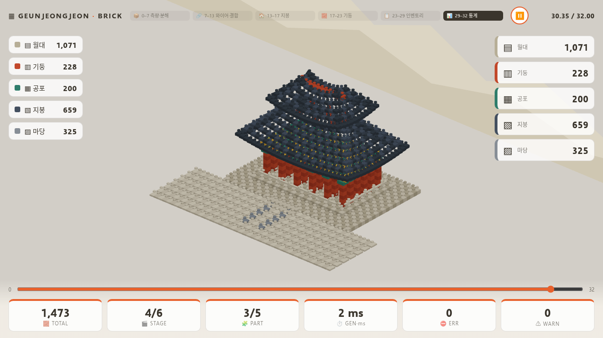
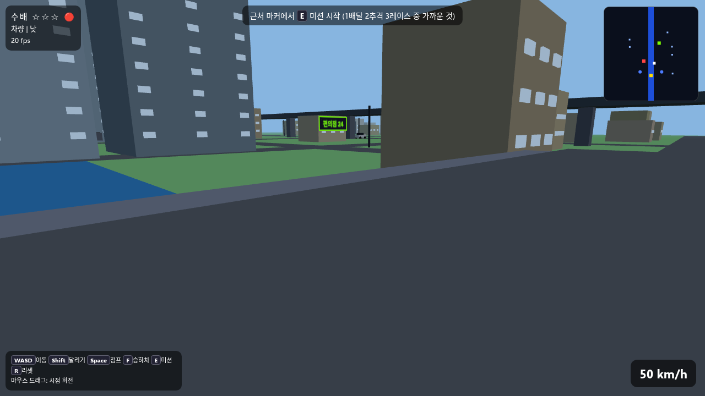
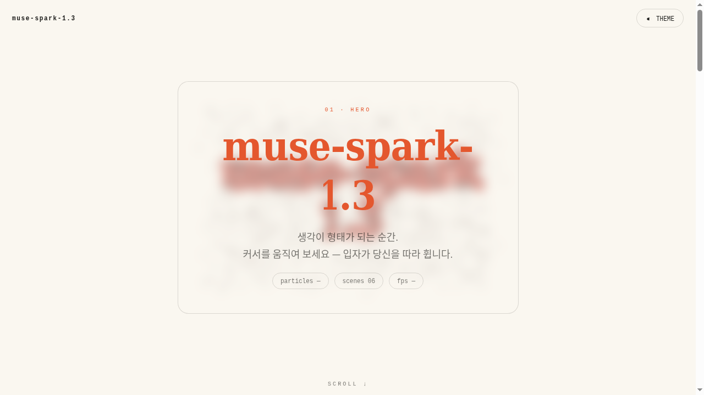
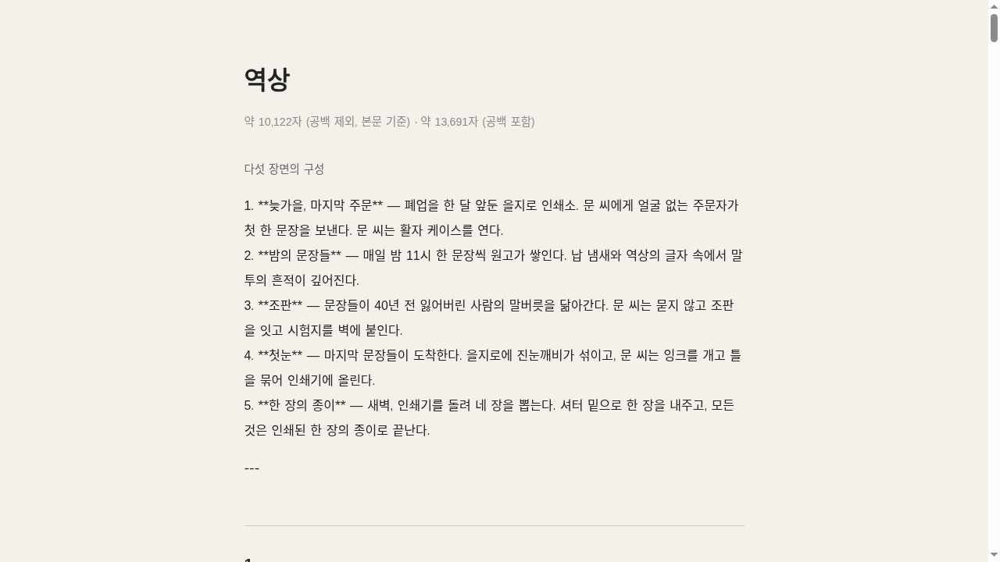
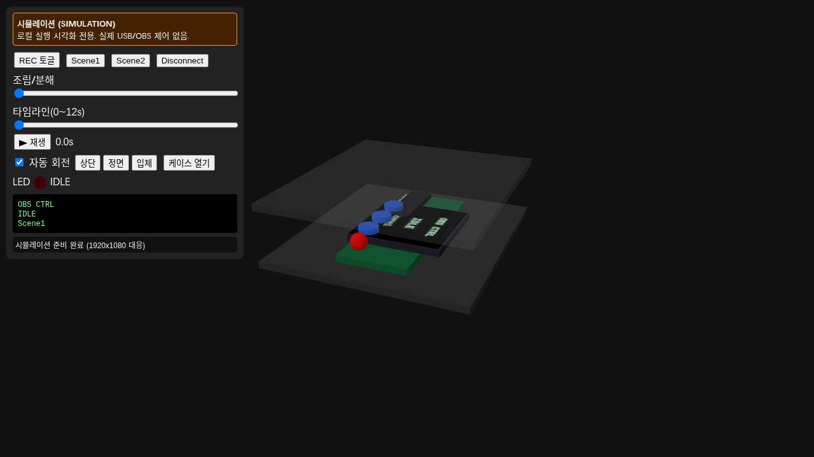

# Muse Spark 1.3 Benchmarks

muse-spark-1.3이 같은 다섯 과제를 구현한 결과를 기록하는 저장소입니다. 원본 저장소(`instinct-benchmarks`)의 구조와 리드미에 보존된 원문 메타프롬프트만을 기준으로 독립 구현했으며, 원본의 결과 수치·스크린샷은 참고하지 않았습니다.

[웹에서 결과 바로 보기](https://sigco3111.github.io/muse-spark-1.3-benchmarks/) · [USB OBS 컨트롤러 3D](https://sigco3111.github.io/muse-spark-1.3-benchmarks/1-controller-3d.html)

## 비교 기록

| 항목 | 이 저장소 |
| --- | --- |
| 실행 주체 | muse-spark-1.3 |
| 과제 출처 | 유튜버 코드팩토리의 메타프롬프트 (원문 `ORIGINAL_PROMPTS.txt`에 그대로 보존) |
| 평가 기준 | 기능 충족·화면 품질·재현성·검증 증거·미검증 항목 |
| 실행 성격 | 단일 구현. 사용자 피드백 반영 수정 없음 |

다른 실행과 비교할 때는 원문 해시, 지정 모델·effort, 실행 날짜, 시간/비용 제한, 수정 라운드를 함께 기록해야 합니다. 값이 없으면 점수나 완료로 채우지 않습니다.

## 결과물

| 과제 | 파일 | 현재 상태 |
| --- | --- | --- |
| 경복궁 근정전 브릭 모션 | [palace.html](palace.html) | 32초 타임라인·시간 슬라이더·파트별 실측 집계 구현. 데스크톱 브라우저 렌더 확인 (2026-11-19) |
| 한강시 3인칭 게임 | [hangang-city.html](hangang-city.html) | 걷기·차량·AI·미션 3종·수배·미니맵·시간순환 구현. 로드·걷기·차량 주행 확인 (2026-11-19), 미션 완주·FPS 실측은 미검증 |
| 모델 소개 스크롤 페이지 | [model-intro.html](model-intro.html) | 입자 구름 6장면 모핑·2테마·로컬 질문 UI. 히어로 장면 렌더 확인 (2026-11-19) (수치는 자리표시자) |
| 을지로 인쇄소 단편 | [웹 읽기](novel.html) · [원고](novel.md) | 제목·5장면 구성·본문 완성, 본문 공백 제외 약 10,122자. 웹 읽기 렌더 확인 (2026-11-19) |
| USB OBS 촬영 컨트롤러 | [3D 웹에서 바로 조작](https://sigco3111.github.io/muse-spark-1.3-benchmarks/1-controller-3d.html) | 설계·펌웨어·브리지·CAD원본·시뮬레이션 미리보기 렌더 확인 (2026-11-19), 실물 미검증 |

## 실행 화면

아래 캡처는 2026-11-19에 배포된 Pages 주소에서 데스크톱 클라우드 브라우저로 직접 캡처한 화면입니다.

### 01 궁전 모션 그래픽 — 경복궁 근정전 브릭 32초



2단 월대와 중층 팔작지붕을 브릭으로 쌓은 근정전. 상단에 6단계 타임라인, 좌우에 파트별 실측 브릭 수(월대 1,071 · 기둥 228 · 공포 200 · 지붕 659 · 마당 325), 하단에 총계·단계·생성시간·오류/경고 카운터가 표시됩니다. 숫자는 코드가 실제로 센 값만 씁니다.

### 02 한강시 게임 — 3인칭 오픈월드



강과 다리 둘, 고층 업무지구와 골목 주택가, 고가도로를 절차적으로 생성한 가상 도시. 차량 주행 중 화면이며 한글 네온 간판(편의점 24), 미니맵, 수배 등급, 속도계가 보입니다. 낮·노을·밤 180초 시간 순환에 따라 밤에는 가로등과 네온이 켜집니다.

### 03 모델 소개 스크롤 페이지



입자 구름이 6개 장면으로 모핑되는 스크롤 랜딩. 커서를 따라 입자가 휘고, 라이트/다크 2테마를 지원합니다. particles·fps 칸의 수치는 지어내지 않고 자리표시자로 둡니다.

### 04 을지로 인쇄소 단편 — 역상



제목과 다섯 장면 구성을 먼저 제시하고 본문을 이어 붙인 단편. 본문 공백 제외 약 10,122자 (검증 기록: [NOVEL_VERIFICATION.md](NOVEL_VERIFICATION.md)).

### 05 USB OBS 촬영 컨트롤러 — 3D 시뮬레이션



조립·분해 타임라인과 케이스 열기, REC/Scene 버튼, OLED 표시를 흉내 낸 시뮬레이션 전용 미리보기. 실제 USB/OBS 제어는 하지 않는다고 화면에 명시합니다.

## 실행

각 HTML을 Chrome/Edge/Safari 등 최신 WebGL 지원 브라우저에서 여세요. `palace.html`·`hangang-city.html`은 three.js 0.170.0, 소개 페이지는 three.js 0.170.0 + GSAP/ScrollTrigger 3.12.5를 CDN에서 읽으므로 인터넷 연결이 필요합니다. 컨트롤러 미리보기(`1-controller-3d.html`)는 three.js 0.152.2 CDN을 사용합니다.

```sh
python3 -m http.server 8000 --bind 127.0.0.1
```

그 뒤 `http://127.0.0.1:8000/`의 목차(`index.html`)에서 실행합니다. 별도 계정·API 키는 필요 없습니다.

## 기술 내용

- **공통**: 외부 3D·이미지 에셋 없이 코드만으로 만드는 단일 HTML 구조. three.js는 importmap으로 CDN에서 읽습니다.
- **palace.html**: three.js 0.170.0. 월대·기둥·공포·지붕·마당 파트 그룹으로 브릭을 생성하고 `length`로 실측 집계해 TOTAL/GEN/ERR에 반영. 0–32초 타임라인과 시간 슬라이더로 임의 프레임 탐색.
- **hangang-city.html**: three.js 0.170.0. mulberry32 시드 난수로 블록마다 성격이 다른 도시를 절차 생성(강·다리 2·고가도로·편의점). 창문·가로등은 InstancedMesh + 거리 컬링. 걷기/달리기/점프, F 승하차, 차량 가속·드리프트·충돌 반동, 신호를 지키는 AI 차량과 보행자, 수배 1–3단계 순찰 추적, 배달·추격·레이스 미션 3종, 180초 낮·노을·밤 순환, 미니맵·속도계 HUD.
- **model-intro.html**: three.js 0.170.0 + GSAP/ScrollTrigger 3.12.5. 입자 구름 6장면 모핑, 라이트/다크 테마, 로컬 질문 UI. 성능 수치는 `{{PLACEHOLDER}}`·`—` 자리표시자.
- **novel.html / novel.md**: 마크다운 원고를 웹 읽기 페이지로 렌더. 분량·요건 점검은 NOVEL_VERIFICATION.md 참고.
- **1-controller-3d.html**: three.js 0.152.2. `controller/preview/index.html`과 동일한 시뮬레이션 미리보기. 설계·배선·펌웨어·호스트 브리지·케이스 원본은 [controller/](controller/README.md)에 문서화.

## 검증과 한계

- [WEB_VERIFICATION.md](WEB_VERIFICATION.md)와 [web-checks.json](web-checks.json)에 실행한 정적 검사를 기록했고, 2026-11-19에 데스크톱 클라우드 브라우저로 다섯 결과물의 실제 렌더를 확인해 위 캡처로 남겼습니다. 조작감·FPS 실측·모바일·prefers-reduced-motion은 하지 않았습니다.
- [NOVEL_VERIFICATION.md](NOVEL_VERIFICATION.md)에 소설 분량·요건 점검을 기록했습니다.
- 컨트롤러는 [controller/VERIFICATION.md](controller/VERIFICATION.md)를 보세요. `py_compile` + host `--dry-run`만 통과했고 실물 제작·실OBS 연동은 미검증입니다.
- 소개 페이지의 성능 수치는 `{{PLACEHOLDER}}`·`—` 자리표시자이며 지어내지 않았습니다.

## 원문 메타프롬프트

전체 원문은 [ORIGINAL_PROMPTS.txt](ORIGINAL_PROMPTS.txt)에 보존합니다. 맞춤법과 자리표시자(`{{MODEL_NAME}}`, `{{EFFORT}}`, `{{TASK_DIR}}`)를 고치지 않은 원문이며, 이 저장소에서는 `{{MODEL_NAME}}` 자리에 `muse-spark-1.3`을 적용해 구현했습니다.
